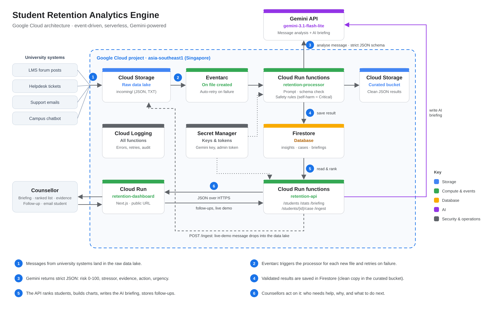

# Student Retention Analytics Engine

**APU Cloud Innovation Hackathon — Data-Driven Research & Intelligent Decision Making track**

Universities usually spot students at risk of dropping out from lagging signals like poor grades and
low attendance, often too late to help. This project reads the **unstructured** messages students
already send (support tickets, LMS forum posts, emails, chatbot conversations), uses **Gemini** to detect
early warning signs such as financial stress, burnout and isolation, and gives counsellors a ranked,
evidence-backed **At-Risk Student Dashboard** — built entirely on **Google Cloud**.

| | |
|---|---|
| **Live dashboard** | https://retention-dashboard-353252835497.asia-southeast1.run.app/ |
| **Demo video** | https://drive.google.com/file/d/1T1EqIYFu2LEnlrxKnHlt71TR79rEgvPn/view?usp=drive_link |

## How it works

1. Student messages from university systems land in the Cloud Storage data lake (`incoming/`).
2. Eventarc triggers the processor for every new file, and retries automatically if anything fails.
3. The processor asks **Gemini** for a strict JSON analysis: risk score 0-100, main stressor, quoted evidence,
   recommended action and urgency. It validates every field and applies the safety rules.
4. Results are saved to Firestore, with a clean copy in the curated bucket.
5. The API ranks students, builds the charts, asks Gemini for a short **AI briefing**, and stores counsellors'
   follow-ups.
6. Counsellors see who needs help, why, and what to do next, then record a follow-up or email the student
   straight from the dashboard.

In production, connectors from the LMS, helpdesk, email and chatbot would drop messages into the data lake
automatically; the dashboard's **Live demo** page simulates one arriving (`POST /ingest`).

## Features

- **AI briefing:** Gemini summarises today's picture in a few sentences: main drivers of risk and who to contact first.
- **Ranked at-risk list** with risk level, trend, stressors, urgency and a **Needs follow-up** filter.
- **Student detail:** risk over time, every analysed message with the AI summary and the exact evidence quotes.
- **Counsellor follow-up:** mark a student Contacted or Resolved with a note; a new message puts them back on the list.
- **Email the student:** one click opens a kind, editable draft tailored to the student's main stressor.
- **Multilingual:** handles Malay and Manglish messages (summaries in English, evidence quoted in the original).
- **Live demo:** send a message and watch the whole Google Cloud pipeline score it in under a minute.

## Why we built it this way

| Decision | Why |
|---|---|
| **Read unstructured messages, not grades** | Grades and attendance are lagging signals. Students describe money worries, burnout or isolation in tickets, forum posts and emails weeks before their marks drop. |
| **Event-driven pipeline (Cloud Storage → Eventarc → Cloud Run functions)** | Every new file is processed automatically, failed runs are retried, and adding a new data source only means dropping files into the bucket. Nothing runs when nothing arrives, so it costs almost nothing when idle. |
| **Serverless everywhere** | No servers to patch or size. Cloud Run functions, Cloud Run and Firestore scale up for a busy exam week and back down to zero. |
| **Gemini 3.1 Flash-Lite with a strict JSON schema** | Fast, low-cost and multilingual. The schema makes every answer machine-checkable, so the code can validate and clamp each field instead of trusting free text. |
| **Current risk = most recent message** | A student who gets help moves down the list instead of being stuck at their worst moment. The peak score is still shown for context. |
| **Firestore, with follow-ups in a separate collection** | Schemaless and serverless, a good fit for AI output. Counsellor follow-ups are stored apart from the AI results, so a human action never rewrites the AI's assessment. |
| **AI briefing cached by a data fingerprint** | Gemini is only called when something changed, so the Overview loads instantly and stays within free-tier limits. If Gemini is unavailable, a plain summary is shown instead. |
| **Malay and Manglish support** | Malaysian students code-switch. Gemini reads both; summaries come back in English for staff while evidence stays in the student's own words. |
| **Singapore region, Secret Manager, no public buckets** | Closest Google Cloud region to Malaysia for low latency; API keys and tokens never appear in code; raw student data is never publicly readable. |

## Responsible AI

- **Safety first, in code:** a possible self-harm signal always makes the student Critical / Immediate and never
  fades on its own, whatever the model says. Safety doesn't depend on prompt wording.
- **Explainable:** every alert shows the exact phrases that triggered it, so counsellors can check the AI's reasoning.
- **Human in the loop:** the AI never contacts a student. Counsellors review and send every email themselves, and
  their follow-ups never change the AI's risk score.
- **Measured:** a hand-labelled answer key of 31 messages, including Malay and Manglish, tests every prompt change:
  100% acceptable risk level, 97% exact, 0 serious misses, every safety flag caught (`backend/eval/`).
- **Prompt-injection guard:** student messages are treated as data, never as instructions.
- **Privacy:** the AI briefing only sees AI summaries and scores, never raw messages; buckets are private; all
  student data in this repo is fictional.

## What's next

- Live connectors for Moodle, Zendesk, the support inbox and the campus chatbot.
- University sign-in for counsellors (Identity-Aware Proxy) and student emails from the directory.
- Gemini through Vertex AI, so no API key is needed at all.
- BigQuery and Looker Studio for term-by-term trend research.
- Student consent and PDPA compliance before using real data.

## Repository

| Folder | What's inside |
|---|---|
| [`backend/`](backend) | Google Cloud pipeline: processor and API (Cloud Run functions), mock data, accuracy test, offline tests |
| [`frontend/`](frontend) | Next.js + Tailwind dashboard (overview, student list, student detail, live demo) |
| [`docs/`](docs) | Architecture diagram and the step-by-step deployment guide |

**Deploy it yourself:** [`docs/deployment.md`](docs/deployment.md) walks through the whole Google Cloud setup.
To run only the dashboard locally against the live API, see [`frontend/README.md`](frontend/README.md).

## Built with

Google Cloud Storage · Eventarc · Cloud Run functions · Firestore · Secret Manager · Cloud Run ·
Gemini API · Python · Next.js · TypeScript · Tailwind CSS

## Team

- **Beryl Abraham Binu — Cloud and pipeline:** Google Cloud architecture, data pipeline, API, deployment
- **Krishnakaanth Shubin — AI, data and pitch:** mock data, Gemini prompt, risk scoring, accuracy testing, pitch deck
- **Hisham Moideen — Frontend and demo:** dashboard, charts, demo flow, demo video
