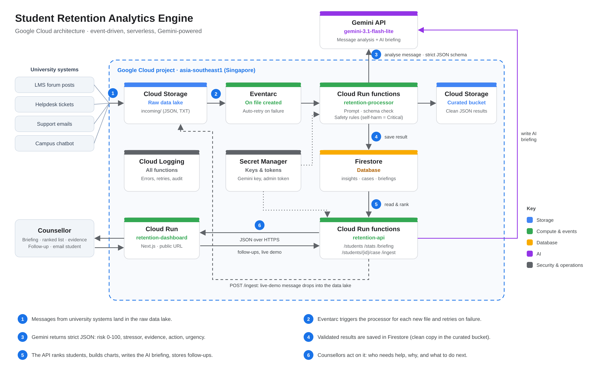

# Backend: Student Retention Analytics Engine (Google Cloud data pipeline)

This folder is the whole Google Cloud side of the project: the data lake, the AI processing step, the
database and the API the dashboard reads. The Next.js dashboard (`../frontend`) only needs the
**API URL** this produces.



## What each piece does

| Piece | What it is | Why we use it |
|---|---|---|
| **Cloud Storage, raw bucket** | Cloud folder storage. `incoming/` holds raw messages exactly as they arrived. | The "data lake": originals are never changed, so we can re-analyse them later with a better prompt. |
| **Cloud Storage, curated bucket** | Cleaned, structured JSON for every analysed message. | The curated zone of the data lake, ready for other tools (e.g. BigQuery) later. |
| **Eventarc** | Google's event router. When a file lands in the raw bucket, it calls the processor. | Event-driven: no polling, no servers. Failed events are **retried automatically** with growing gaps for up to 24 hours. |
| **Cloud Run function `retention-processor`** | Python code that runs only when there is work. | Sends each message to Gemini, checks the answer, saves it. At most **2 copies run at once**, which keeps us under Gemini's free-tier limit. |
| **Gemini API** | Google's AI model. | Turns messy text into structured JSON: risk score, stressor, quoted evidence, recommended action. |
| **Firestore** | Google's serverless NoSQL database. | Stores one document per analysed message for the dashboard. |
| **Cloud Run function `retention-api`** | The public web address the dashboard calls (`/students`, `/stats`, …). | Reads Firestore and returns ready-to-chart JSON; `/ingest` adds live demo messages. |
| **Secret Manager** | Encrypted storage for secrets. | Holds the Gemini key and the demo-reset token, so neither is in the code or on GitHub. |
| **Service account `retention-fn`** | The identity both functions run as. | Least privilege: it can only use Firestore, the buckets, the two secrets and logging. |
| **Cloud Logging** | Everything the functions print. | How we see what happened (`gcloud functions logs read …`). |

## Folder map

```
backend/
├── src/
│   ├── processor/
│   │   ├── main.py            # entry point Google Cloud calls for each new file
│   │   ├── app.py             # the real work: Gemini prompt, safety rules, saving
│   │   └── requirements.txt   # Google Cloud libraries the function needs
│   └── api/
│       ├── main.py            # entry point for web requests (CORS, JSON)
│       ├── app.py             # routes: /students, /stats, /insights, /briefing, /ingest, /students/{id}/case, /admin/reset-demo
│       └── requirements.txt
├── mock_data/                 # fictional student messages in 4 messy formats
├── eval/                      # answer key and accuracy test for the Gemini prompt
├── scripts/test_gemini_key.py # checks your Gemini key and previews AI output locally
└── tests/test_offline.py      # 32 tests, no Google Cloud or internet needed
```

## Run the tests

From this folder (Python 3.11+, no Google Cloud account or internet needed):

```
python -m unittest discover -s tests
```

32 tests cover the processor (validation, safety rules, retries), every API route, follow-ups, the AI briefing
cache and the demo reset, using in-memory fakes of Cloud Storage and Firestore. To check a Gemini key and preview
the AI output for one message, set `GEMINI_API_KEY` and run `python scripts/test_gemini_key.py`. The prompt's
accuracy test is in [`eval/`](eval).

## API reference

Base URL of the live deployment: `https://retention-api-soaznw43ya-as.a.run.app` (try `https://retention-api-soaznw43ya-as.a.run.app/students` in a browser).
For local dashboard development, put it in `frontend/.env.local`:

```
NEXT_PUBLIC_API_BASE_URL=https://retention-api-soaznw43ya-as.a.run.app
```

(No trailing slash. Restart `npm run dev` after editing `.env.local`.)

| Method | Path | Use it for |
|---|---|---|
| GET | `/health` | "Is the backend up?" |
| GET | `/stats` | KPI cards and charts (risk distribution, stressors, daily trend) |
| GET | `/briefing` | AI briefing for the Overview: `{"headline", "points": [2-4 strings], "source": "ai"\|"summary", "generated_at"}` |
| GET | `/students` | The at-risk student table, highest risk first (each row includes the follow-up fields below) |
| GET | `/students/{student_id}` | Student detail page with full timeline and `case_history` (newest first) |
| POST | `/students/{student_id}/case` | Counsellor follow-up. Body: `{"status": "OPEN"\|"CONTACTED"\|"RESOLVED", "note": "max 500 chars"}` → the saved case |
| GET | `/insights?risk_level=HIGH,CRITICAL&stressor=FINANCIAL&student_id=TP071234&limit=50` | Raw signal feed (all filters optional) |
| POST | `/ingest` | Body: `{"student_id","student_name","source","text"}` → `202 {"status":"queued","object_key":...}` |
| POST | `/admin/reset-demo` | Header `X-Admin-Token: <admin-token secret>` → `{"deleted": n, "remaining": n, "cases_cleared": n}` |

**AI briefing:** the API sends Gemini a compact snapshot (each student's risk level, trend, stressors, self-harm
flag, the one-line AI summary and follow-up status; never the raw message text) and gets back a headline and 2-4
points. The result is saved in Firestore (`briefings/latest`) with a fingerprint of the data, so Gemini is only
called again after a new message is analysed, a follow-up is saved or the demo is reset. If Gemini is busy, the
quota is used up or the key is missing, `/briefing` returns a plain summary built from the numbers
(`"source": "summary"`) instead of failing.

**Follow-up fields** on every student: `case_status` (`OPEN` until a counsellor saves one), `case_note`,
`case_updated_at`, `case_new_message` (the student wrote again after the last update) and `needs_follow_up`
(`OPEN`, or a new message arrived). `/stats` adds `awaiting_follow_up`: High/Critical students that need follow-up.
Follow-ups live in their own Firestore collection (`cases`, one document per student), so a counsellor never
changes the AI's results or risk score. In this prototype anyone with the dashboard link can save a follow-up;
a real deployment would put the dashboard behind university sign-in (for example Identity-Aware Proxy).

**Allowed values**

- `risk_level`: `LOW` (0-29), `MEDIUM` (30-59), `HIGH` (60-79), `CRITICAL` (80-100)
- `primary_stressor`: `FINANCIAL`, `ACADEMIC_PRESSURE`, `BURNOUT_MENTAL_HEALTH`, `SOCIAL_ISOLATION`,
  `TECHNOLOGY_ACCESS`, `FAMILY_PERSONAL`, `HEALTH_PHYSICAL`, `HOUSING_TRANSPORT`, `NONE`
- `urgency`: `ROUTINE`, `FOLLOW_UP_THIS_WEEK`, `CONTACT_WITHIN_24H`, `IMMEDIATE`
- `trend` (students only): `NEW`, `RISING`, `FALLING`, `STABLE` (latest message compared with the one before it)
- `source_system`: `LMS_FORUM`, `SUPPORT_TICKET`, `EMAIL`, `CHATBOT`, `OTHER`

**How a student's risk is worked out (`/students`):** `current_risk_*`, `highest_urgency` and
`recommended_action` come from the student's **most recent** message, so a student who gets help drops
down the list. Safety rule: if any message was flagged for self-harm, the student stays `CRITICAL` /
`IMMEDIATE` no matter what they send later. `peak_risk_score` / `peak_risk_level` keep the highest-risk
message ever, for context.

**Compatibility note:** each insight has `source_uri` (`gs://…`) and the same value as `s3_uri`, and `/ingest`
returns `object_key` plus the same value as `s3_key`. The duplicates keep the dashboard working unchanged
from the first version; new code should use `source_uri` and `object_key`.

**Example: `GET /students`**

```json
{
  "count": 10,
  "items": [
    {
      "student_id": "TP070455",
      "student_name": "Priya Nair",
      "signal_count": 3,
      "current_risk_score": 95,
      "current_risk_level": "CRITICAL",
      "latest_risk_score": 95,
      "peak_risk_score": 95,
      "peak_risk_level": "CRITICAL",
      "average_risk_score": 71.7,
      "trend": "RISING",
      "top_stressors": ["BURNOUT_MENTAL_HEALTH", "ACADEMIC_PRESSURE"],
      "self_harm_flag": true,
      "highest_urgency": "IMMEDIATE",
      "recommended_action": "Contact the student today and connect them with campus counselling services.",
      "latest_summary": "Student expresses hopelessness and asks how to stop everything.",
      "first_event_time": "2026-10-03T17:12:00Z",
      "latest_event_time": "2026-11-06T18:40:00Z",
      "sources": ["CHATBOT", "LMS_FORUM"]
    }
  ]
}
```

**Example: one item from `GET /insights` (also the shape of each `timeline` entry)**

```json
{
  "record_id": "a1b2c3d4e5f6a7b8c9d0e1f2",
  "student_id": "TP071234",
  "student_name": "Aisyah Rahman",
  "source_system": "EMAIL",
  "risk_score": 67,
  "risk_level": "HIGH",
  "primary_stressor": "FINANCIAL",
  "secondary_stressors": ["ACADEMIC_PRESSURE"],
  "sentiment": "NEGATIVE",
  "summary": "Student cannot cover a fee gap after a loan delay and is working nights.",
  "evidence": ["remaining RM 4,850", "working nights at a cafe", "really want to continue my degree"],
  "recommended_action": "Refer to the bursary for an instalment plan or hardship fund this week.",
  "urgency": "FOLLOW_UP_THIS_WEEK",
  "self_harm_indicator": false,
  "event_time": "2026-10-13T15:41:00Z",
  "event_date": "2026-10-13",
  "raw_text": "From: \"Aisyah Rahman\" <tp071234@student.uni.example> ...",
  "source_uri": "gs://your-project-raw/incoming/historical/02_email.txt",
  "s3_uri": "gs://your-project-raw/incoming/historical/02_email.txt",
  "is_live": false,
  "processed_at": "2026-11-11T09:12:45Z",
  "model": "gemini-3.1-flash-lite"
}
```

**Example: `GET /stats`**

```json
{
  "total_signals": 20,
  "total_students": 10,
  "students_needing_attention": 6,
  "self_harm_alerts": 0,
  "average_risk_score": 52.4,
  "signals_by_risk_level": [{"level": "LOW", "count": 5}, {"level": "MEDIUM", "count": 5}, {"level": "HIGH", "count": 7}, {"level": "CRITICAL", "count": 3}],
  "students_by_risk_level": [{"level": "LOW", "count": 2}, {"level": "MEDIUM", "count": 2}, {"level": "HIGH", "count": 4}, {"level": "CRITICAL", "count": 2}],
  "signals_by_stressor": [{"stressor": "FINANCIAL", "count": 5}, {"stressor": "ACADEMIC_PRESSURE", "count": 4}],
  "signals_by_source": [{"source": "EMAIL", "count": 6}, {"source": "LMS_FORUM", "count": 7}],
  "timeline": [{"date": "2026-10-02", "signals": 1, "avg_risk_score": 45.0, "high_or_critical": 0}],
  "generated_at": "2026-11-11T09:20:00Z"
}
```

(Exact numbers depend on what Gemini returns.)

## Deploy it

The full step-by-step guide (Google Cloud project, services, permissions, deploying both functions and the
dashboard, loading the data, troubleshooting) is in [`../docs/deployment.md`](../docs/deployment.md).
